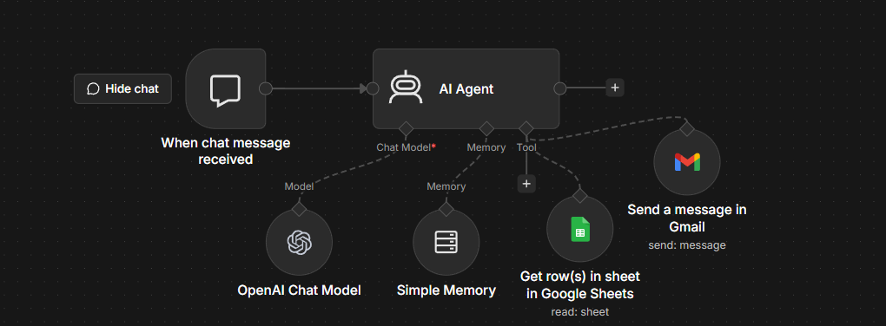
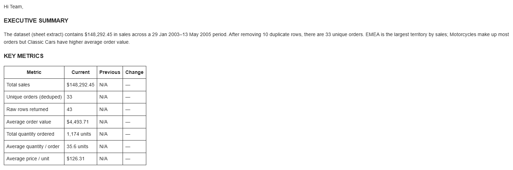

# AI Data Analysis Agent (n8n)

An n8n workflow where an AI agent reads data from Google Sheets, analyzes it, and emails a structured HTML insights report to stakeholders.

## Problem

Business reports are often built by hand: pull the data, calculate metrics, write the summary, send the email. This project automates that loop. The agent fetches the data, validates it, analyzes it, and delivers a consistent, readable report by email.

## How It Works



```
Chat Trigger -> AI Agent (OpenAI chat model + Simple Memory)
                  |-- Google Sheets tool  (reads the data)
                  |-- Gmail tool          (sends the HTML report)
```

1. A message in the chat starts the workflow (for example: "Analyze the customer data and email me the report").
2. The agent reads rows from Google Sheets using the Sheets tool.
3. It follows the analysis process defined in the system prompt: understand the request, validate the data, calculate metrics, interpret the findings, recommend actions.
4. It sends the final report through the Gmail tool as an HTML email.

## Tech Stack

- **n8n**: workflow automation and AI Agent node
- **OpenAI chat model**: reasoning and report writing
- **Simple Memory**: conversation context
- **Google Sheets**: data source
- **Gmail**: report delivery

## Analysis Process (defined in the system prompt)

1. Understand the business question, period and metrics
2. Fetch data only through the tools (no invented data)
3. Validate: row count, date range, missing values, duplicates, outliers
4. Analyze: KPIs, comparisons, top and bottom performers, anomalies
5. Interpret: what happened, why it likely happened, why it matters
6. Recommend: 2 to 4 specific, actionable next steps
7. Send the report by email

The full prompt is in [`system_prompt.md`](system_prompt.md).

## Email Report Format

- Subject line with the report name, period and headline insight
- Executive summary (2 to 3 sentences)
- Key metrics table
- Key insights (3 to 5 bullets)
- Detailed breakdown tables (top performers)
- Anomalies and risks
- Recommendations
- Data notes (source, row count, assumptions, data quality)

## Sample Output



The test run used a sample customer list (29 customers across 24 cities) and produced a summary, a metrics table, insights, top and bottom city breakdowns, recommendations and data notes.

## How to Run

1. Import `workflow.json` into n8n (**Workflows -> Import from file**).
2. Connect your own credentials: OpenAI, Google Sheets and Gmail.
3. In the Google Sheets tool, select your document and sheet.
4. In the Gmail tool, set the recipient. Set **Subject** and **Message** to be filled by the model (click the sparkle icon next to each field) and set Email Type to **HTML**.
5. Paste the contents of `system_prompt.md` into the AI Agent's **System Message**.
6. Open the chat, send a request, and check your inbox.

## Challenges and Fixes

- **Empty emails:** the Gmail tool sent blank messages because Subject and Message were not set to be filled by the AI. Enabling "Let the model define this parameter" and instructing the agent in the prompt to always pass the full body fixed it.
- **Old errors repeating in reports:** Simple Memory carried earlier failures into new reports. Clear the memory (or start a new chat session) between test runs and tell the agent in the prompt never to mention tooling or earlier emails.
- **Table layout without a comparison period:** when there is no previous period, the Previous and Change columns show N/A. The prompt switches to a two-column Metric and Value table in that case.

## Limitations

- The test dataset is a customer list with no numeric measures, so the analysis is limited to counts by city.
- The AI does the calculations. For reliable numbers, KPIs should be computed in SQL or a code step and passed to the agent for interpretation.
- The workflow is triggered manually from chat, not on a schedule.

## Next Steps

- [ ] Add orders and payments data to report revenue, growth, top customers and monthly trends
- [ ] Compute KPIs with SQL queries or an n8n Code node, and let the agent interpret the results
- [ ] Add charts to the email report
- [ ] Replace the chat trigger with a weekly schedule trigger
- [ ] Check the agent's numbers against manually run queries

## Repository Structure

```
.
├── README.md
├── workflow.json
├── system_prompt.md
├── sample_data/
│   └── sample_customers.csv
└── screenshots/
    ├── workflow.png
    └── sample_email.png
```

## Notes

- Credentials, email addresses and sheet IDs have been removed from `workflow.json`. Replace the placeholders with your own values.
- Only sample data is used in this repository.

## Author

**Ashish Shinde**, Pune, India
Building towards Data Analyst roles (SQL, Power BI, Excel).
