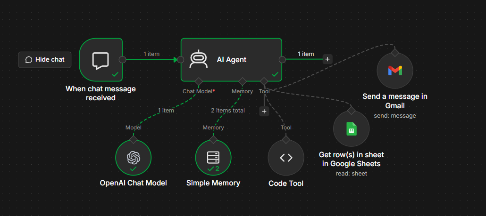
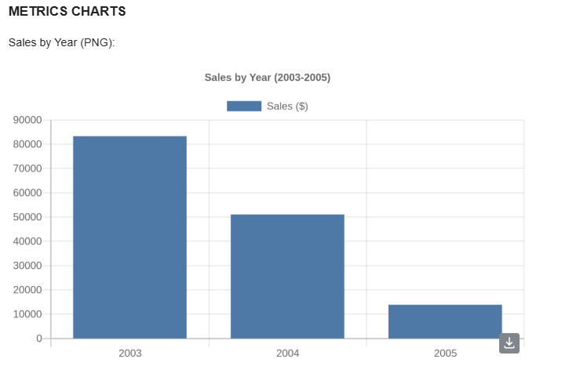
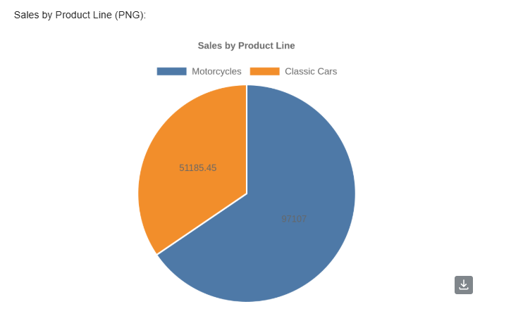
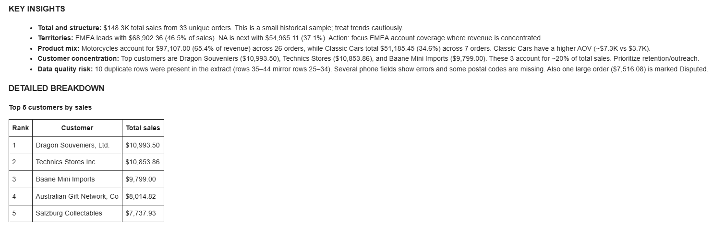
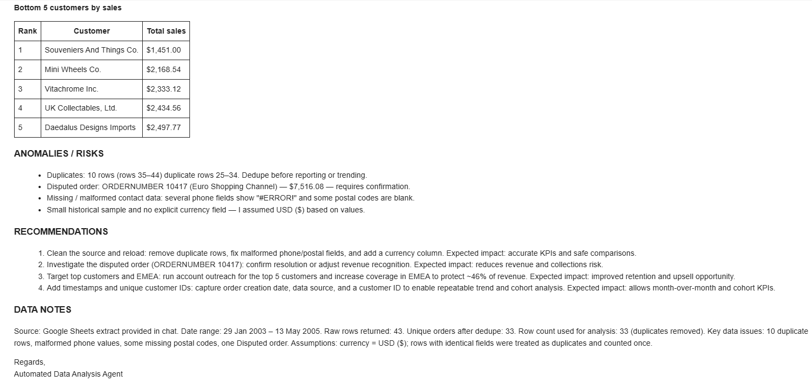

# AI Data Analysis Agent (n8n)

An n8n workflow where an AI agent reads data from Google Sheets, analyzes it, creates charts, and emails a structured HTML insights report to stakeholders.

This project started as a text-and-table reporting agent and has been evolving step by step. The latest improvement adds automatic chart creation inside the workflow.

## Problem

Business reports are often built by hand: pull the data, calculate metrics, write the summary, build the charts, send the email. This project automates that loop. The agent fetches the data, validates it, analyzes it, creates charts, and delivers a consistent, readable report by email.

## Current Workflow


```
Chat Trigger -> AI Agent (OpenAI chat model + Simple Memory)
                  |-- Google Sheets tool  (reads the data)
                  |-- Code Tool           (creates the charts)
                  |-- Gmail tool          (sends the HTML report)
```

1. A message in the chat starts the workflow (for example: "Analyze the sales data, add charts and email me the report").
2. The agent reads rows from Google Sheets using the Sheets tool.
3. It follows the analysis process defined in the system prompt: understand the request, validate the data, calculate metrics, interpret the findings, recommend actions.
4. It calls the Code Tool to turn the key numbers into chart images.
5. It sends the final report, with the charts embedded, through the Gmail tool as an HTML email.

## How the Workflow Evolved

| Stage | What I built | What I learned |
|---|---|---|
| Starting point | Agent that reads Google Sheets and emails an analysis of a customer list | Gmail tool fields must be filled by the model, or the email arrives blank |
| Improvement | Tightened the prompt: consistent email format, no tool or error talk in reports, table layout without a comparison period | Memory can carry old errors into new reports |
| **Latest: chart creation** | Added a Code Tool that builds chart images, so reports include visuals such as Sales by Year and Sales by Product Line | Let code build the chart configuration; the model should only supply labels and numbers |

### The workflow before charts


### The workflow after adding chart creation



The only structural change is the new **Code Tool** connected to the agent. The rest of the workflow stayed the same.

## Tech Stack

- **n8n**: workflow automation and AI Agent node
- **OpenAI chat model**: reasoning and report writing
- **Simple Memory**: conversation context
- **Google Sheets**: data source
- **Code Tool (JavaScript) + QuickChart**: chart creation
- **Gmail**: report delivery

## Analysis Process (defined in the system prompt)

1. Understand the business question, period and metrics
2. Fetch data only through the tools (no invented data)
3. Validate: row count, date range, missing values, duplicates, outliers
4. Analyze: KPIs, comparisons, top and bottom performers, anomalies
5. Interpret: what happened, why it likely happened, why it matters
6. Recommend: 2 to 4 specific, actionable next steps
7. Create charts for the key metrics
8. Send the report by email

The full prompt is in [`system_prompt.md`](system_prompt.md).

## Email Report Format

- Subject line with the report name, period and headline insight
- Executive summary (2 to 3 sentences)
- Key metrics table
- Key insights (3 to 5 bullets)
- Charts
- Detailed breakdown tables (top performers)
- Anomalies and risks
- Recommendations
- Data notes (source, row count, assumptions, data quality)

## Sample Output

### Report with charts (latest)

**Sales by Year**



**Sales by Product Line**



### Earlier report (before charts)

The first test run used a sample customer list (29 customers across 24 cities) and produced a summary, a metrics table, insights, top and bottom city breakdowns, recommendations and data notes.





## How Chart Creation Works

- The agent sends the chart details (chart type, title, labels, values) to the Code Tool as JSON.
- The Code Tool validates the input and builds a QuickChart image URL.
- The agent places the returned URL in an `` tag in the HTML email.

Design choices:
- Charts are built in code, not by the model, so the chart configuration is always valid.
- The agent only supplies simple inputs (labels and numbers), never a full chart configuration.
- The prompt tells the agent to use chart URLs exactly as returned and never to invent them.

## How to Run

1. Import `workflow.json` into n8n (**Workflows -> Import from file**).
2. Connect your own credentials: OpenAI, Google Sheets and Gmail.
3. In the Google Sheets tool, select your document and sheet.
4. In the Code Tool, set the name to `create_chart` and keep the description from the repo so the agent knows how to call it.
5. In the Gmail tool, set the recipient. Set **Subject** and **Message** to be filled by the model (click the sparkle icon next to each field) and set Email Type to **HTML**.
6. Paste the contents of `system_prompt.md` into the AI Agent's **System Message**.
7. Open the chat, send a request such as "Analyze the sales data, add charts and email me the report", and check your inbox.

## Challenges and Fixes

- **Empty emails:** the Gmail tool sent blank messages because Subject and Message were not set to be filled by the AI. Enabling "Let the model define this parameter" and instructing the agent in the prompt to always pass the full body fixed it.
- **Old errors repeating in reports:** Simple Memory carried earlier failures into new reports. Clear the memory (or start a new chat session) between test runs and tell the agent in the prompt never to mention tooling or earlier emails.
- **Table layout without a comparison period:** when there is no previous period, the Previous and Change columns show N/A. The prompt switches to a two-column Metric and Value table in that case.
- **Charts failing with the QuickChart node:** the agent put a full chart configuration into a field that only accepts a list of numbers, and the node returned an image file that the Gmail tool cannot embed. Replacing it with a Code Tool that builds the chart URL fixed this.
- **Broken images in the email:** the agent wrote image tags without a valid URL, or altered a long encoded URL. The prompt now requires the agent to call the chart tool first and copy the returned URL exactly.
- **Memory node error "No session ID found":** this appears when a node is run on its own instead of through the chat trigger. Running the full workflow from the chat avoids it.

## Limitations

- The AI still does some of the calculations. For reliable numbers, KPIs should be computed in SQL or a code step and passed to the agent for interpretation.
- Charts are limited to a small number of categories per chart.
- The workflow is triggered manually from chat, not on a schedule.
- Numbers in the report should be checked against the source data before being shared.

## Next Steps

- [x] Add charts to the email report
- [ ] Compute KPIs with SQL queries or an n8n Code node, and let the agent interpret the results
- [ ] Add orders and payments data to report revenue, growth, top customers and monthly trends
- [ ] Replace the chat trigger with a weekly schedule trigger
- [ ] Check the agent's numbers against manually run queries

## Repository Structure

```
.
├── README.md
├── workflow.json
├── system_prompt.md
├── sample_data/
│   └── sample_customers.csv
└── images/
    ├── workflow.png
    ├── workflow_chart.png
    ├── sample_email_1.png
    ├── sample_email_2.png
    ├── sample_email_3.png
    ├── sample_email_chart1.png
    └── sample_email_chart2.png
```

## Notes

- Credentials, email addresses and sheet IDs have been removed from `workflow.json`. Replace the placeholders with your own values.
- Only sample data is used in this repository.

## Author

**Ashish Shinde**, Pune, India
Building towards Data Analyst roles (SQL, Power BI, Excel).
